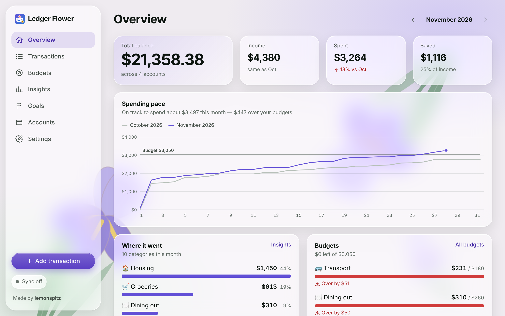

# Ledger Flower

A personal budgeting app for Android, iPhone, Windows, macOS and the web that keeps every device
in step in real time. One codebase (React + TypeScript), packaged with
Capacitor for Android and iPhone, Electron for desktop, and as an installable web app.

**Try it in your browser:** https://lemonspitz.github.io/ledger-flower/ · **Downloads:** [Releases](https://github.com/lemonspitz/ledger-flower/releases)

## Screenshots



| Overview | Budgets | About your flower |
| :---: | :---: | :---: |
|  |  |  |


<details>
<summary>All 30 flower themes</summary>


</details>

*Screenshots use the built-in sample data.*

## What it does

- **Overview** – total balance, income / spending / saved for the month with change vs last month, a day-by-day spending pace line against last month and your budget, top categories, budget meters, 6-month cash flow, recent and upcoming items.
- **Transactions** – expenses, income and transfers between accounts; search and filter by month, type, category and account.
- **Bill & split** – type each menu item with its base price (or scan the receipt) and the app adds service charge and tax (optionally tax on top of service, as with PB1), applies a discount, and shows the total. Add friends, tap who had each item (unassigned items are shared by everyone), and each person's share is worked out with service and tax divided in proportion, adding up exactly to the bill. Share the breakdown to a chat. If you paid for everyone, only your share counts as spending and the rest is tracked under Accounts → Owed to me until each friend settles up.
- **Payment methods** – record how each expense was paid: cash, a card (name, last 4 digits, network) or a QR bank/app (QRIS, GoPay, OVO, DANA, ShopeePay, PayNow…). Add them while entering an expense or under Settings → Payment methods; filter transactions by them and see spending per method in Insights. Scanned receipts pick the method up from lines like "VISA ****4821" or "GOPAY".
- **Receipt scanning** – inside Bill & split: take a photo or pick an image and the menu lines (name, quantity, price each), service, tax and discount fill the bill. Order/table/receipt numbers, dates, times, cashier, phone numbers and loyalty points are ignored; layouts like "2 x 20.000  40.000" under the item name, "2x Nasi Goreng", "Name 2 @ 18.500 37.000" and Qty/Price/Total columns are understood. Photos are cropped to the receipt paper, enlarged and cleaned (local threshold) before reading, and the result is cross-checked: line totals against quantity × price, items against the printed subtotal, and subtotal + service + tax against the grand total, so common misreads ("@27.000" as "627.000") are corrected. Service and tax can be entered as printed amounts — the rate is worked out, including whether tax was charged on service — or as percentages. Receipts are understood in all the app's languages: local words for subtotal, tax, service and total (小計 · 合計 · 소계 · รวมทั้งสิ้น · Tổng cộng · ИТОГ · Zwischensumme · Att betala · الإجمالي…), local money formats (1,234.56 · 1.234,56 · 1 234,50 ₽ · ¥1,234 · 12.000đ · Arabic-Indic digits), and tax that is already in the prices (Europe, Japan, Thailand…) is told apart from tax added on top. The text reader uses the model for the app's language (Japanese, Chinese, Korean, Thai, Arabic, Russian and Vietnamese have their own; the rest use the English one). The image is read on the device (bundled Tesseract OCR) and never uploaded. Test receipts, including readings of a real photo: `npm test`; accuracy on real and generated receipts: see [Receipt accuracy](#receipt-accuracy).
- **Calculator entry** – the amount field has a built-in keypad (shown by default on phones, one tap away on desktop), so `3.49 + 9.75 + 4.50` is totalled for you. Any amount field also accepts a typed sum.
- **Pull-up menu** – on phones, drag the bottom bar up to see every section.
- **Sub-categories** – every category can have its own list (Groceries › Vegetables, Meat & fish, …); add new ones while entering a transaction or in Settings.
- **Budgets** – monthly limit per category with remaining amount, per-day allowance and over/at-risk warnings.
- **Insights** – 3/6/12-month view: balance trend, income vs spending, category ranking, weekday pattern, per-category trends, largest expenses, and plain-language observations.
- **Goals** – savings targets with progress and the monthly amount needed to hit a date.
- **Accounts & recurring** – multiple accounts with balances; bills and paychecks that enter themselves.
- **Flower themes** – a frosted-glass design with large flower illustrations behind the glass, in 30 themes, each in light and dark. **Flowers of Indonesia** (10 natives): Rafflesia (Rafflesia arnoldii), Titan Arum, Javanese Edelweiss, Black Orchid, Tiger Orchid, Vanda Tricolor, Torch Ginger, Clove, Ylang-ylang (kenanga) and Champak (cempaka). **Flowers of the world** (20): Iris, Rose, Sunflower, Cherry Blossom, Lavender, Sacred Lotus, Tulip, Moon Orchid, Jasmine, Hibiscus, Madonna Lily, Daisy, Poppy, Peony, Magnolia, Frangipani, Bird of Paradise, Camellia, Bluebell and Marigold. Each comes with a short field guide: Latin name, Indonesian name where there is one, family, origin, where it grows, bloom season, meaning and facts. Chart colours in every theme use pairs checked for colour-blind readability. Pick one under Settings → Preferences.
- **Number format** – Settings → Preferences: 1,234.56 · 1.234,56 · 1 234,56 · 1'234.56 · 1,23,456.78, or the device's own style, plus decimals Automatic/Always/Never (Automatic hides cents for Rupiah and similar). Typed amounts follow the same style, so with 1.234,56 typing 1.000 means one thousand.
- **Excel report** – Settings → Your data → *Export Excel report* makes a workbook in your flower theme's colours: an **Overview** with headline numbers and three native Excel charts (income and spending by month, where the money went, balance over time), then tidy tables of **Transactions**, **Monthly**, **Categories** (with share bars and over-budget highlights) and **Accounts**. The tables are real Excel tables: styled headers, banded rows, frozen header, filters, true dates and numbers in your currency, no merged cells or subtotal rows, so sorting, pivots and formulas just work. The spreadsheet library loads only when you export.
- **Tidy CSV** – one row per transaction, oldest first: ISO dates, signed amounts (spending negative), currency, category and payment method in their own columns, UTF-8 that Excel opens correctly.
- **Import from other apps and spreadsheets** – Settings → Your data → *Import from another app or spreadsheet* reads CSV/TSV, Excel (.xlsx, .xls), OpenDocument and Numbers files: exports from Money Manager, Wallet, Spendee, Monefy, Money Lover, YNAB, Mint, Toshl, Bluecoins, Goodbudget, AndroMoney, bank statements, or any sheet you made yourself. The header row is found even under a title or account details; each column's meaning is worked out from its name (in 20+ languages) and its contents; dates (31/12, 12/31, 2024-12-31, "5 Mar 2024", 2024年3月5日, Excel day numbers), amounts (1,234.56 · 1.234,56 · (12.50) · "50,000.00 DB"), money-in/money-out columns, income/expense/transfer words and two-line transfers are understood. Imported category and account names are matched to yours (same name, a sub-category, or a common word like "Food" → Dining out) or added as new; rows without a category are sorted from their notes, by what your earlier transactions with similar notes were, or by well-known shop names. Everything can be changed on one screen with a preview, rows already in the app are skipped, an import can be undone, and your choices are remembered so the next file from the same app imports without questions. Runs on the device; nothing is uploaded. Tests: `npx tsx test/import.test.ts`.
- **Data** – JSON backup/restore, light and dark themes, 30+ currencies.
- **22 languages** – English, Bahasa Indonesia, Bahasa Melayu, Tagalog, ไทย, Tiếng Việt, 日本語, 한국어, 简体中文, 繁體中文, العربية (right-to-left), Türkçe, Русский, Français, Deutsch, Español, Português, Norsk, Dansk, Svenska, Suomi and Kiswahili. Follows the device language or pick one in Settings → Preferences. Dates, weekdays and plurals follow the language; built-in categories are translated while your own names stay as typed. The flower field guide is in English and Indonesian.
- **App lock** – a 4–6 digit PIN on every device, plus fingerprint or face unlock on phones. Locks on opening and after leaving the app (immediately, 1 or 5 minutes). Only a salted PBKDF2 hash of the PIN is stored, on that device only.
- **Reminders** (Android, iPhone) – a daily nudge to log spending (tap it to add a transaction), heads-ups before recurring bills, and alerts when a budget reaches 80% and 100%. Scheduled on the device; nothing is sent to a server.
- **Home-screen widget** (Android) – this month's spending, budget left with a progress bar, today's spending, and a + button that opens Add transaction. Follows light/dark mode and your language.

## Web version

**https://lemonspitz.github.io/ledger-flower/** — the same app in any browser, published automatically from `main` by `.github/workflows/pages.yml`. It can be installed (Safari: Share → Add to Home Screen; Chrome/Edge: Install app) and works offline after the first visit; the receipt reader is stored on the device the first time you scan. Data lives in that browser and syncs with your other devices through your sync code. Tip for iPhone: use it from the Home Screen icon, since Safari can clear data of websites not opened for a while, while installed web apps keep theirs.

## Sync

Settings → *Turn on sync* creates a 20-character code. Enter that code on your
other devices and they share one budget. Changes appear on the other devices
in about a second; a device that was offline catches up when it reconnects.

How it works: the code is turned into encryption keys on each device. Data is
gzipped, encrypted with AES-256-GCM and stored as signed, replaceable events
(Nostr protocol) on relay servers; each device holds a live WebSocket
subscription. Relays only see ciphertext. Merging is per record, newest edit
wins, and deletes are kept as tombstones so they propagate.

The default relays are free public servers with no uptime guarantee. Every
device holds a full copy of your data, so a relay outage only delays sync. To
depend on nobody, run your own:

```bash
npm run relay
```

Put it behind HTTPS and add its `wss://` address under Settings → Sync → Show
servers on each device. (The Android app can only use `wss://`, not `ws://`.)

Anyone who has the sync code can read the budget — treat it like a password.

## Develop and build

```bash
npm install
```

```bash
npm run dev
```

```bash
npm run dist:win
```

```bash
npm run dist:mac
```

```bash
npm run android
```

- Windows build output: `release/Ledger Flower Setup 1.11.0.exe` (installer) and a portable `.exe`. Building on Linux needs Wine.
- macOS output: `release/Ledger-Flower-1.11.0-mac-arm64.zip` (Apple silicon) and `-x64.zip` (Intel). When building on Linux, `scripts/sign-mac.sh` (run by `npm run dist:mac`) adds an ad-hoc signature with [rcodesign](https://github.com/indygreg/apple-platform-rs) (`cargo install apple-codesign --locked`); Apple-silicon Macs won't launch an unsigned app.
- Android output: `android/app/build/outputs/apk/debug/app-debug.apk`. Needs the Android SDK (`ANDROID_HOME`) and JDK 21.

### iPhone (iOS 16.4 or later)

iPhone apps can only be built on a Mac with Xcode (free from the App Store). The `ios/` folder is a ready Xcode project.

```bash
npm install
```

```bash
npm run ios
```

That builds the app, copies it into the iOS project and opens Xcode. In Xcode: select the **App** target → **Signing & Capabilities** → tick *Automatically manage signing* and pick your **Team** (sign in with your Apple ID under Xcode → Settings → Accounts). Plug in your iPhone (or pick it over Wi-Fi), choose it at the top, and press **Run**. On the iPhone, allow the developer under Settings → General → VPN & Device Management the first time.

With a free Apple ID the app works for 7 days, then Run it again from Xcode. A paid Apple Developer Program membership (US$99/year) gives year-long installs, TestFlight for friends, and App Store release.

The desktop apps are unsigned. Windows SmartScreen will ask for confirmation
(More info → Run anyway). On macOS, after unzipping, clear the download flag once:

```bash
xattr -cr "/Applications/Ledger Flower.app"
```

## Receipt accuracy

The scanner is Tesseract OCR plus hand-written rules (no cloud, no trained model). The rules are measured and tuned against receipts with known answers:

**Real receipts – [CORD](https://huggingface.co/datasets/naver-clova-ix/cord-v2)** (1,000 Indonesian receipt photos with hand-checked contents by NAVER Clova, CC BY 4.0; not stored in this repo). Rules were tuned on the 800 training receipts and scored on the other 200, which were not looked at while tuning:

| Held-out 200 receipts | Before tuning | Now |
|---|---|---|
| Text as printed: every item right | 75.5% | 84.0% |
| Text as printed: total right | 86.0% | 95.9% |
| Text as printed: subtotal right | 75.0% | 95.5% |
| Text as printed: tax right | 85.9% | 94.1% |
| Photo → OCR → rules: every item right | 42.3% | 45.0% |
| Photo → OCR → rules: total right | 40.7% | 42.9% |

On photos the OCR is the limit: many CORD pictures are small, creased or at an angle. A clear, flat, close photo reads far better than these numbers suggest.

**Every app language – generated receipts.** There are no public sets of real, annotated receipts for most of the app's languages, so `bench/synth.ts` makes 500 per language that follow each country's conventions: local words for subtotal, tax, service and total, local money formats, tax added on top or already included, and four item layouts. "Bill adds up" means the bill the app fills in (items − discount + service + tax) equals what was paid.

| | en | ms | tl | th | vi | ja | ko | zh-Hans | zh-Hant | ar | tr | ru | fr | de | es | pt | nb | da | sv | fi | sw |
|---|---|---|---|---|---|---|---|---|---|---|---|---|---|---|---|---|---|---|---|---|---|
| Text, 500 each | 100 | 99 | 100 | 99 | 100 | 100 | 100 | 99 | 88 | 99 | 100 | 100 | 100 | 99 | 99 | 100 | 100 | 100 | 100 | 99 | 95 |
| Printed + OCR, 20 each | 100 | 100 | 75 | 60 | 95 | 45 | 55 | 55 | 60 | 0 | 80 | 70 | 100 | 95 | 100 | 90 | 90 | 60 | 100 | 100 | 90 |

(% of receipts whose bill adds up.) Latin-script receipts read well. Japanese, Chinese, Korean, Thai and Russian work but miss more; Arabic receipts are not yet read reliably (the text reader mixes up right-to-left order and Arabic-Indic digits), so check those by hand. Generated receipts are cleaner than real ones, so treat these as an upper bound.

Run them yourself:

```bash
npx tsx bench/cord.ts <cord-dir> --split heldout          # CORD, text only
npx tsx bench/synth.ts                                     # 500 per language, text only
npx vite --port 5199 &                                     # then the photo runs:
node bench/ocr-run.cjs <cord-dir> ocr.json --split heldout && npx tsx bench/cord.ts <cord-dir> --split heldout --ocr ocr.json
npx tsx bench/synth.ts --dump synth && node bench/synth-ocr.cjs synth synth-ocr.json --per 20 && npx tsx bench/synth.ts --ocr synth-ocr.json
```

`<cord-dir>` holds `index.json` and `img/<id>.png|jpg` + `img/<id>.json`, extracted from the dataset's parquet files.

## Releases

Releases are built on GitHub's machines by `.github/workflows/release.yml`. **To publish a new version, bump `version` in `package.json` and push to `main`.** If that version has no release yet, the workflow runs the tests, builds the Android APK, the Windows installer and portable `.exe` and both Mac zips (ad-hoc signed), then creates the release and its tag `v<version>`. The notes list the commits since the previous release.

Pushing a tag yourself works too; it must match `package.json`, and an annotated tag's message becomes the notes:

```bash
git tag -a v1.13.0 -m "What changed in this version"
```

```bash
git push origin v1.13.0
```

To rebuild an existing release, run **Release** from the Actions tab and enter its tag; the files are replaced.

The APK is signed with the key in the repository secret `ANDROID_KEYSTORE_B64` (the keystore, base64-encoded), so each new APK installs as an update over the last. Without the secret the APK is skipped, since an APK signed with another key can't update the installed app.

## Translations

All interface text goes through `t()` in `src/i18n.ts`, with English as the key. `npm run i18n` collects every string into `src/locales/keys.ts` (new strings are appended, so existing translations keep their place) and checks each language file in `src/locales/` for length and matching `{placeholders}`; `npm test` runs the same check. Plurals use the language's own forms (`{ one, few, many, other }`). Only the active language is downloaded.

## Layout

| Path | What |
|---|---|
| `src/store.ts` | local-first data store, merge rules, recurring items |
| `src/sync.ts` | encrypted relay sync engine |
| `src/split.ts`, `src/bill.tsx` | bill calculator, splitting maths and the Bill & split screen |
| `src/receipt.ts` | on-device receipt OCR and parsing |
| `src/flowers.ts` | the 30 flower themes: colours and field-guide info |
| `src/themes.tsx` | theme CSS, flower drawings and the backdrop |
| `src/calc.ts`, `src/charts.tsx` | derived figures and SVG charts |
| `src/views.tsx`, `src/forms.tsx`, `src/App.tsx` | screens, dialogs, shell and settings |
| `electron/main.cjs` | desktop window |
| `android/` | Capacitor Android project |
| `server/relay.mjs` | optional self-hosted sync relay |


Ledger Flower was called Ledgerleaf before version 1.11. Updating keeps your data: app IDs, storage and sync codes are unchanged.
