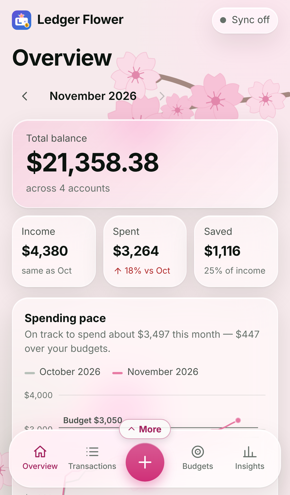
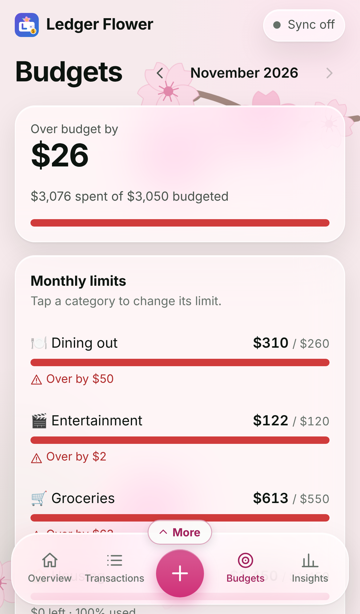
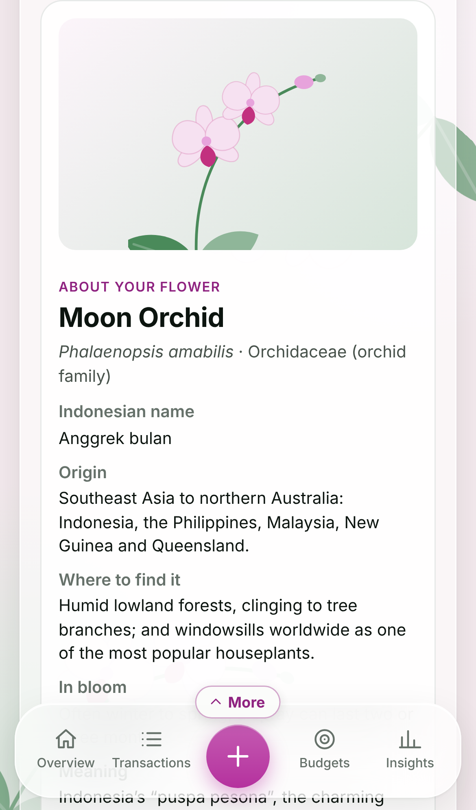
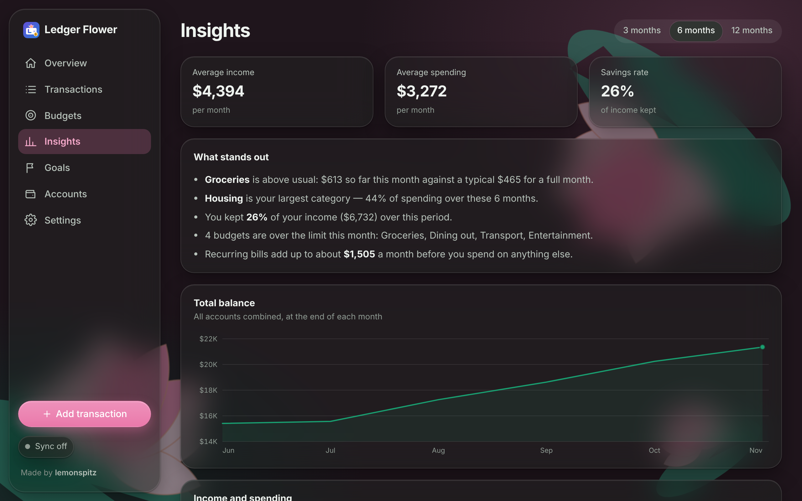
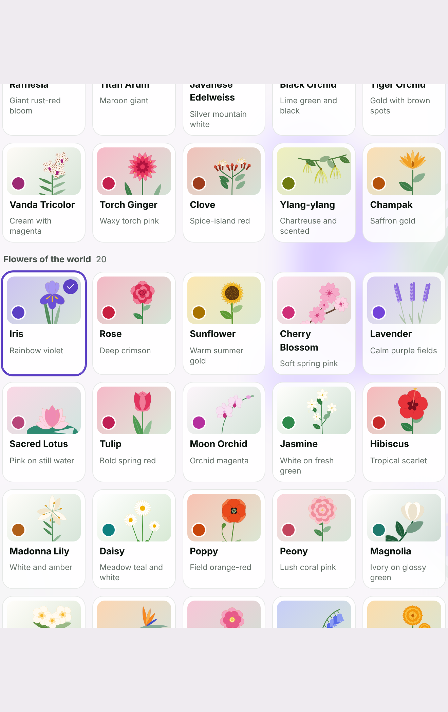

# Ledger Flower

A personal budgeting app for Android, iPhone, Windows, macOS and the web that keeps every device
in step in real time. One codebase (React + TypeScript), packaged with
Capacitor for Android and iPhone, Electron for desktop, and as an installable web app.

**Try it in your browser:** https://lemonspitz.github.io/ledger-flower/ · **Downloads:** [Releases](https://github.com/lemonspitz/ledger-flower/releases)

## Screenshots


| Overview | Budgets | About your flower |
| :---: | :---: | :---: |
|  |  |  |



<details>
<summary>All 30 flower themes</summary>



</details>

*Screenshots use the built-in sample data.*

## What it does

- **Overview** – total balance, income / spending / saved for the month with change vs last month, a day-by-day spending pace line against last month and your budget, top categories, budget meters, 6-month cash flow, recent and upcoming items.
- **Transactions** – expenses, income and transfers between accounts; search and filter by month, type, category and account.
- **Bill & split** – type each menu item with its base price (or scan the receipt) and the app adds service charge and tax (optionally tax on top of service, as with PB1), applies a discount, and shows the total. Add friends, tap who had each item (unassigned items are shared by everyone), and each person's share is worked out with service and tax divided in proportion, adding up exactly to the bill. Share the breakdown to a chat. If you paid for everyone, only your share counts as spending and the rest is tracked under Accounts → Owed to me until each friend settles up.
- **Payment methods** – record how each expense was paid: cash, a card (name, last 4 digits, network) or a QR bank/app (QRIS, GoPay, OVO, DANA, ShopeePay, PayNow…). Add them while entering an expense or under Settings → Payment methods; filter transactions by them and see spending per method in Insights. Scanned receipts pick the method up from lines like "VISA ****4821" or "GOPAY".
- **Receipt scanning** – inside Bill & split: take a photo or pick an image and the menu lines (name, quantity, price each), service, tax and discount fill the bill. Order/table/receipt numbers, dates, times, cashier, phone numbers and loyalty points are ignored; layouts like "2 x 20.000  40.000" under the item name, "2x Nasi Goreng", "Name 2 @ 18.500 37.000" and Qty/Price/Total columns are understood. Photos are cropped to the receipt paper, enlarged and cleaned (local threshold) before reading, and the result is cross-checked: line totals against quantity × price, items against the printed subtotal, and subtotal + service + tax against the grand total, so common misreads ("@27.000" as "627.000") are corrected. Service and tax can be entered as printed amounts — the rate is worked out, including whether tax was charged on service — or as percentages. The image is read on the device (bundled Tesseract OCR) and never uploaded. Test receipts, including readings of a real photo: `npm test`.
- **Calculator entry** – the amount field has a built-in keypad (shown by default on phones, one tap away on desktop), so `3.49 + 9.75 + 4.50` is totalled for you. Any amount field also accepts a typed sum.
- **Pull-up menu** – on phones, drag the bottom bar up to see every section.
- **Sub-categories** – every category can have its own list (Groceries › Vegetables, Meat & fish, …); add new ones while entering a transaction or in Settings.
- **Budgets** – monthly limit per category with remaining amount, per-day allowance and over/at-risk warnings.
- **Insights** – 3/6/12-month view: balance trend, income vs spending, category ranking, weekday pattern, per-category trends, largest expenses, and plain-language observations.
- **Goals** – savings targets with progress and the monthly amount needed to hit a date.
- **Accounts & recurring** – multiple accounts with balances; bills and paychecks that enter themselves.
- **Flower themes** – a frosted-glass design with large flower illustrations behind the glass, in 30 themes, each in light and dark. **Flowers of Indonesia** (10 natives): Rafflesia (Rafflesia arnoldii), Titan Arum, Javanese Edelweiss, Black Orchid, Tiger Orchid, Vanda Tricolor, Torch Ginger, Clove, Ylang-ylang (kenanga) and Champak (cempaka). **Flowers of the world** (20): Iris, Rose, Sunflower, Cherry Blossom, Lavender, Sacred Lotus, Tulip, Moon Orchid, Jasmine, Hibiscus, Madonna Lily, Daisy, Poppy, Peony, Magnolia, Frangipani, Bird of Paradise, Camellia, Bluebell and Marigold. Each comes with a short field guide: Latin name, Indonesian name where there is one, family, origin, where it grows, bloom season, meaning and facts. Chart colours in every theme use pairs checked for colour-blind readability. Pick one under Settings → Preferences.
- **Number format** – Settings → Preferences: 1,234.56 · 1.234,56 · 1 234,56 · 1'234.56 · 1,23,456.78, or the device's own style, plus decimals Automatic/Always/Never (Automatic hides cents for Rupiah and similar). Typed amounts follow the same style, so with 1.234,56 typing 1.000 means one thousand.
- **Data** – CSV export, JSON backup/restore, light and dark themes, 30+ currencies.

## Web version

**https://lemonspitz.github.io/ledger-flower/** — the same app in any browser, published automatically from `main` by `.github/workflows/pages.yml`. It can be installed (Safari: Share → Add to Home Screen; Chrome/Edge: Install app) and works offline after the first visit; the receipt reader is stored on the device the first time you scan. Data lives in that browser and syncs with your other devices through your sync code. Tip for iPhone: use it from the Home Screen icon, since Safari can clear data of websites not opened for a while, while installed web apps keep theirs.

## Sync

Settings → *Turn on sync* creates a 20-character code. Enter that code on your
other devices and they share one budget. Changes appear on the other devices
in about a second; a device that was offline catches up when it reconnects.

How it works: the code is turned into encryption keys on each device. Data is
gzipped, encrypted with AES-256-GCM and stored as signed, replaceable events
(Nostr protocol) on relay servers; each device holds a live WebSocket
subscription. Relays only see ciphertext. Merging is per record, newest edit
wins, and deletes are kept as tombstones so they propagate.

The default relays are free public servers with no uptime guarantee. Every
device holds a full copy of your data, so a relay outage only delays sync. To
depend on nobody, run your own:

```bash
npm run relay
```

Put it behind HTTPS and add its `wss://` address under Settings → Sync → Show
servers on each device. (The Android app can only use `wss://`, not `ws://`.)

Anyone who has the sync code can read the budget — treat it like a password.

## Develop and build

```bash
npm install
```

```bash
npm run dev
```

```bash
npm run dist:win
```

```bash
npm run dist:mac
```

```bash
npm run android
```

- Windows build output: `release/Ledger Flower Setup 1.11.0.exe` (installer) and a portable `.exe`. Building on Linux needs Wine.
- macOS output: `release/Ledger-Flower-1.11.0-mac-arm64.zip` (Apple silicon) and `-x64.zip` (Intel). When building on Linux, `scripts/sign-mac.sh` (run by `npm run dist:mac`) adds an ad-hoc signature with [rcodesign](https://github.com/indygreg/apple-platform-rs) (`cargo install apple-codesign --locked`); Apple-silicon Macs won't launch an unsigned app.
- Android output: `android/app/build/outputs/apk/debug/app-debug.apk`. Needs the Android SDK (`ANDROID_HOME`) and JDK 21.

### iPhone (iOS 16.4 or later)

iPhone apps can only be built on a Mac with Xcode (free from the App Store). The `ios/` folder is a ready Xcode project.

```bash
npm install
```

```bash
npm run ios
```

That builds the app, copies it into the iOS project and opens Xcode. In Xcode: select the **App** target → **Signing & Capabilities** → tick *Automatically manage signing* and pick your **Team** (sign in with your Apple ID under Xcode → Settings → Accounts). Plug in your iPhone (or pick it over Wi-Fi), choose it at the top, and press **Run**. On the iPhone, allow the developer under Settings → General → VPN & Device Management the first time.

With a free Apple ID the app works for 7 days, then Run it again from Xcode. A paid Apple Developer Program membership (US$99/year) gives year-long installs, TestFlight for friends, and App Store release.

The desktop apps are unsigned. Windows SmartScreen will ask for confirmation
(More info → Run anyway). On macOS, after unzipping, clear the download flag once:

```bash
xattr -cr "/Applications/Ledger Flower.app"
```

## Releases

Releases are built on GitHub's machines by `.github/workflows/release.yml`. **To publish a new version, bump `version` in `package.json` and push to `main`.** If that version has no release yet, the workflow runs the tests, builds the Android APK, the Windows installer and portable `.exe` and both Mac zips (ad-hoc signed), then creates the release and its tag `v<version>`. The notes list the commits since the previous release.

Pushing a tag yourself works too; it must match `package.json`, and an annotated tag's message becomes the notes:

```bash
git tag -a v1.13.0 -m "What changed in this version"
```

```bash
git push origin v1.13.0
```

To rebuild an existing release, run **Release** from the Actions tab and enter its tag; the files are replaced.

The APK is signed with the key in the repository secret `ANDROID_KEYSTORE_B64` (the keystore, base64-encoded), so each new APK installs as an update over the last. Without the secret the APK is skipped, since an APK signed with another key can't update the installed app.

## Layout

| Path | What |
|---|---|
| `src/store.ts` | local-first data store, merge rules, recurring items |
| `src/sync.ts` | encrypted relay sync engine |
| `src/split.ts`, `src/bill.tsx` | bill calculator, splitting maths and the Bill & split screen |
| `src/receipt.ts` | on-device receipt OCR and parsing |
| `src/flowers.ts` | the 30 flower themes: colours and field-guide info |
| `src/themes.tsx` | theme CSS, flower drawings and the backdrop |
| `src/calc.ts`, `src/charts.tsx` | derived figures and SVG charts |
| `src/views.tsx`, `src/forms.tsx`, `src/App.tsx` | screens, dialogs, shell and settings |
| `electron/main.cjs` | desktop window |
| `android/` | Capacitor Android project |
| `server/relay.mjs` | optional self-hosted sync relay |


Ledger Flower was called Ledgerleaf before version 1.11. Updating keeps your data: app IDs, storage and sync codes are unchanged.
